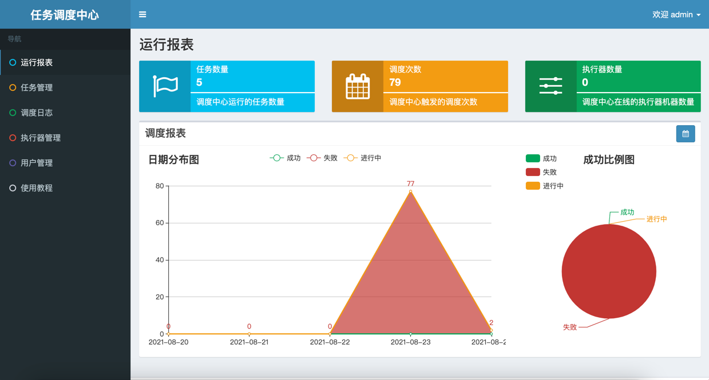

# xxl-job-demo
任务调度的demo实现，其中包括了任务的调度中心，还有模拟的执行器

# xxl-job-admin
 xxl-job-admin 是基于 xxl-job-core 的封装，类似于一个管理系统，对任务和执行器进行一些简单的管理，
 
# 如何使用
找到项目的db文件夹下的sql文件执行，注意，需要mysql8.0及以上的版本才可以，
端口好和数据源自行进行配置，进入admin页面之后默认用户名和密码是 admin 123456

登录成功之后页面如下所示

